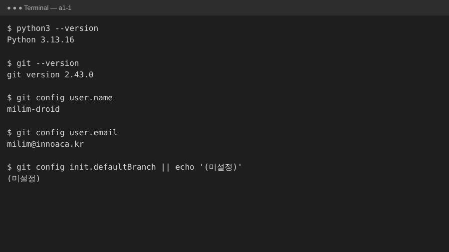
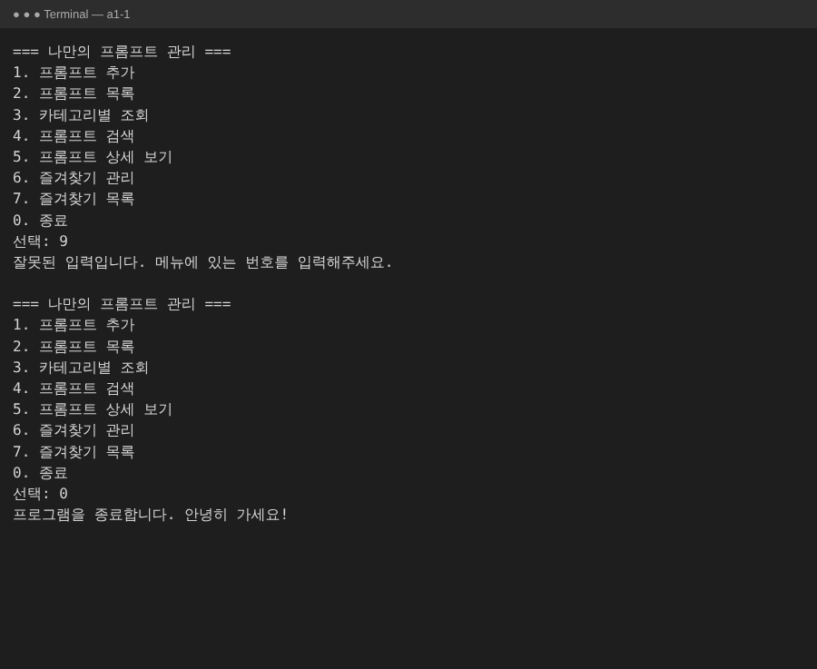
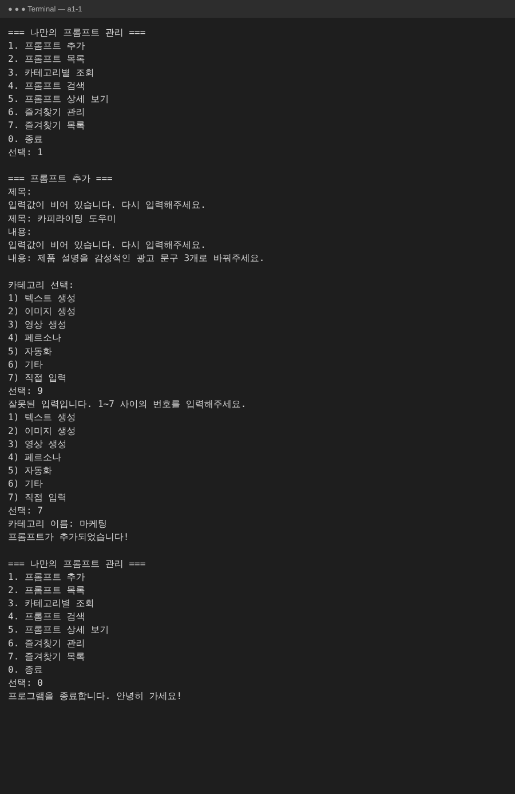
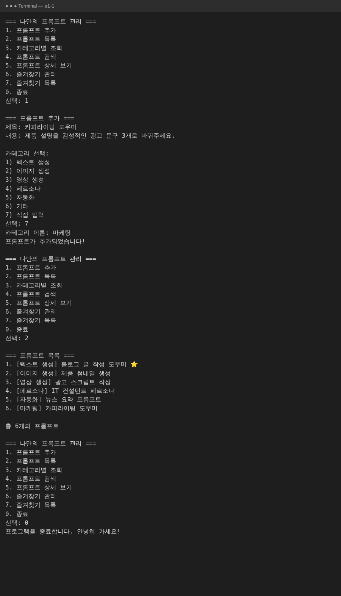
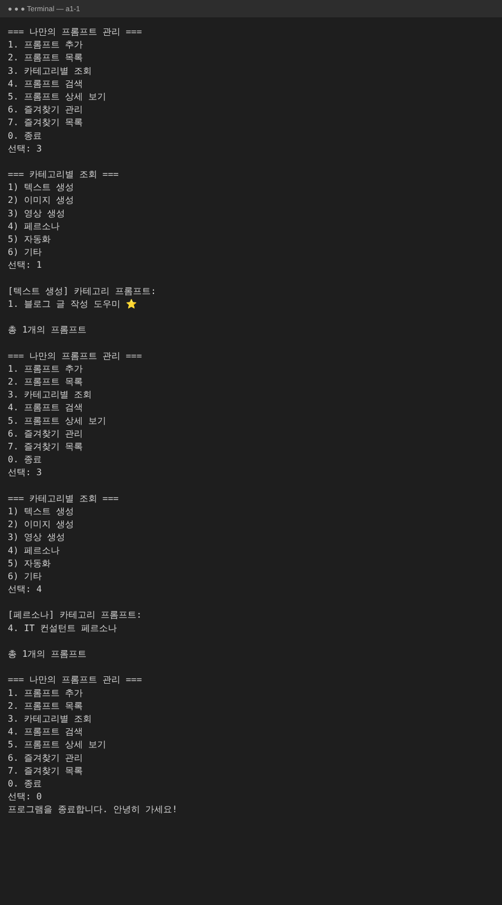
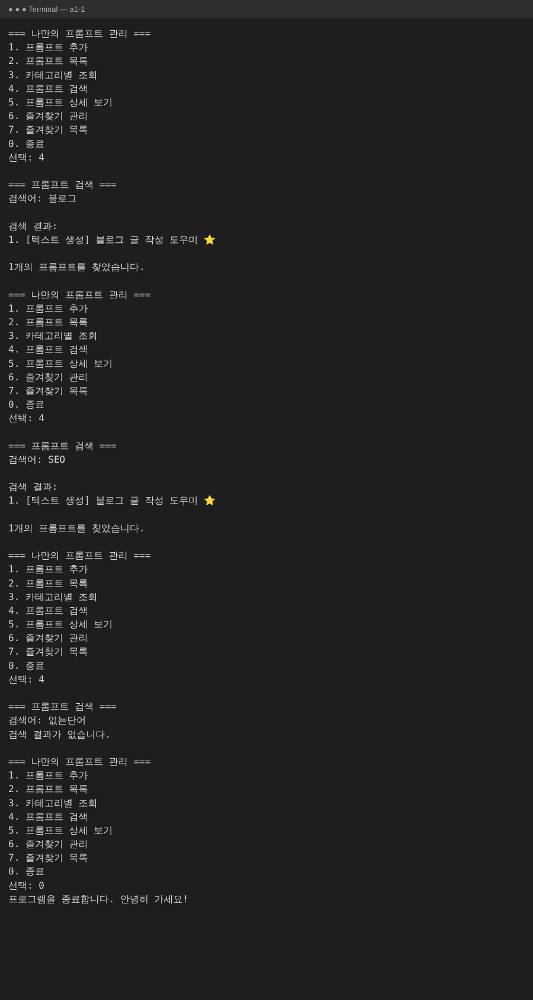
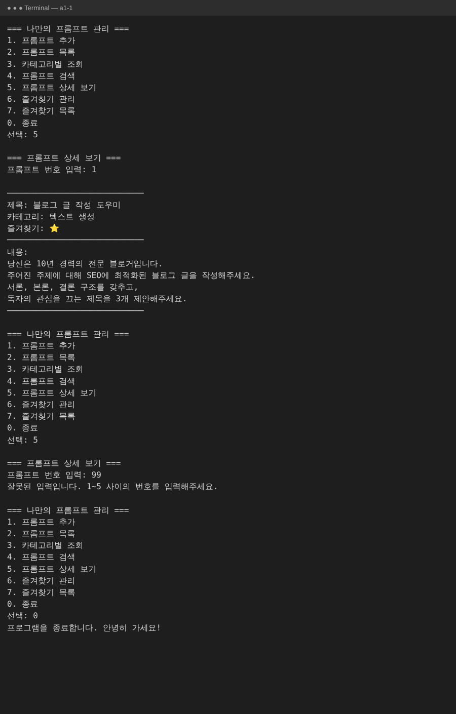
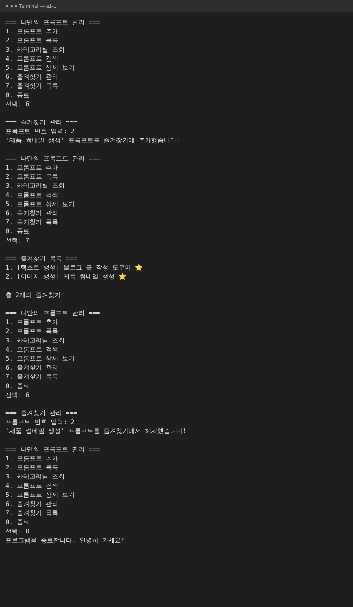
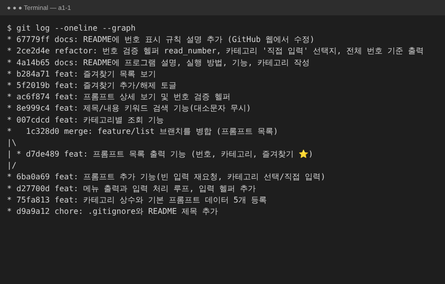

# 나만의 프롬프트 관리 프로그램

GenAI 미션을 하며 쌓인 프롬프트를 **한곳에서 분류·검색·즐겨찾기로 관리**하는 Python 콘솔 프로그램입니다.
터미널에서 메뉴 번호를 입력해 기능을 사용하며, 외부 라이브러리 없이 Python 기본 문법(변수, 조건문, 반복문, 함수, 리스트, 딕셔너리)만 사용했습니다.

> 프롬프트 추가·즐겨찾기 변경 내용은 **프로그램 실행 중에만 유지**되고, 종료하면 기본 데이터로 초기화됩니다.

## 목차

1. [실행 방법](#1-실행-방법)
2. [기능 목록](#2-기능-목록)
3. [프롬프트 카테고리](#3-프롬프트-카테고리)
4. [실행 화면](#4-실행-화면)
5. [코드 구조](#5-코드-구조)
6. [Git 작업 기록](#6-git-작업-기록)

## 1. 실행 방법

**요구 사항:** Python 3.10 이상 (외부 라이브러리 설치 불필요)

```bash
python --version                                 # 3.10 이상인지 확인
git clone https://github.com/milim-droid/a1-1.git
cd a1-1
python prompt_manager.py                         # 환경에 따라 python3
```

실행하면 메뉴가 출력되고, 번호를 입력해 기능을 선택합니다. `0`을 입력하면 종료됩니다.

## 2. 기능 목록

| 번호 | 기능 | 설명 | 담당 함수 |
|---|---|---|---|
| 1 | 프롬프트 추가 | 제목·내용·카테고리 입력. 빈 값이면 다시 입력을 요청하고, 카테고리는 목록에서 고르거나 `직접 입력`. 즐겨찾기 기본값은 `False` | `add_prompt()` |
| 2 | 프롬프트 목록 | 번호, 카테고리, 제목, 즐겨찾기(⭐)를 표시. 프롬프트가 없으면 안내 메시지 출력 | `show_list()` |
| 3 | 카테고리별 조회 | 카테고리를 고르면 해당 프롬프트만 출력. 없으면 안내 메시지 출력 | `show_by_category()` |
| 4 | 프롬프트 검색 | 키워드가 **제목 또는 내용**에 포함된 프롬프트 검색(대소문자 무시). 없으면 안내 메시지 출력 | `search_prompt()` |
| 5 | 프롬프트 상세 보기 | 번호를 입력하면 제목·카테고리·즐겨찾기·내용 전체 출력. 잘못된 번호는 안내 | `show_detail()` |
| 6 | 즐겨찾기 관리 | 번호를 입력해 즐겨찾기를 추가/해제(같은 번호를 다시 입력하면 해제) | `toggle_favorite()` |
| 7 | 즐겨찾기 목록 | 즐겨찾기한 프롬프트만 모아서 출력 | `show_favorites()` |
| 0 | 종료 | 프로그램 종료 | `main()` |

**공통 동작**
- 잘못된 메뉴 번호를 입력하면 안내 메시지를 출력하고 메뉴를 다시 보여줍니다.
- 각 기능이 끝나면 메뉴로 돌아옵니다.
- **번호 규칙:** 검색·카테고리별 조회·즐겨찾기 목록에 표시되는 번호는 "프롬프트 목록"의 번호와 같습니다.
  어느 화면에서 본 번호든 상세 보기(5)와 즐겨찾기 관리(6)에 그대로 입력할 수 있습니다.
- 숫자가 아닌 입력, 범위를 벗어난 번호, 빈 입력은 모두 안내 후 다시 입력받습니다.

## 3. 프롬프트 카테고리

| 카테고리 | 용도 |
|---|---|
| 텍스트 생성 | 블로그 글, 이메일 등 글쓰기용 프롬프트 |
| 이미지 생성 | 썸네일, 광고 이미지 등 이미지 생성용 키워드·지시문 |
| 영상 생성 | 광고 스크립트, 영상 장면 구성용 프롬프트 |
| 페르소나 | AI에게 역할·말투·관점을 부여하는 프롬프트 |
| 자동화 | 요약, 정리 등 반복 업무를 자동화하는 프롬프트 |
| 기타 | 위 분류에 속하지 않는 프롬프트 |

프롬프트를 추가할 때 `7) 직접 입력`을 선택하면 위 6개 외의 새 카테고리도 만들 수 있습니다.

**기본 등록 프롬프트 (5개)**

| 카테고리 | 제목 | 즐겨찾기 |
|---|---|---|
| 텍스트 생성 | 블로그 글 작성 도우미 | ⭐ |
| 이미지 생성 | 제품 썸네일 생성 | |
| 영상 생성 | 광고 스크립트 작성 | |
| 페르소나 | IT 컨설턴트 페르소나 | |
| 자동화 | 뉴스 요약 프롬프트 | |

**데이터 구조:** 프롬프트 하나는 딕셔너리, 전체는 리스트로 저장합니다.

```python
prompts = [
    {"title": "블로그 글 작성 도우미", "content": "...", "category": "텍스트 생성", "favorite": True},
    {"title": "제품 썸네일 생성",     "content": "...", "category": "이미지 생성", "favorite": False},
]
```

## 4. 실행 화면

### 개발 환경 (Python / Git 버전, Git 설정)


### 메뉴 · 잘못된 입력 · 종료


### 프롬프트 추가 (빈 입력 재요청, 카테고리 직접 입력)


### 프롬프트 목록


### 카테고리별 조회


### 프롬프트 검색


### 프롬프트 상세 보기


### 즐겨찾기 관리 · 즐겨찾기 목록


### git log --oneline --graph


## 5. 코드 구조

모든 코드는 `prompt_manager.py` 한 파일에 있으며, 기능별 함수로 분리되어 있습니다.

```
prompt_manager.py
├── CATEGORIES, prompts      # 카테고리 상수, 기본 프롬프트 데이터(list + dict)
├── read_nonempty()          # 빈 값이 아닐 때까지 입력 반복
├── read_number()            # 숫자·범위 검증
├── choose_category()        # 카테고리 선택 / 직접 입력
├── format_line()            # "1. [카테고리] 제목 ⭐" 공통 출력 형식
├── show_menu()              # 메뉴 출력
├── add_prompt()             # 1. 프롬프트 추가
├── show_list()              # 2. 프롬프트 목록
├── show_by_category()       # 3. 카테고리별 조회
├── search_prompt()          # 4. 프롬프트 검색
├── show_detail()            # 5. 프롬프트 상세 보기 (ask_prompt_number() 사용)
├── toggle_favorite()        # 6. 즐겨찾기 추가/해제
├── show_favorites()         # 7. 즐겨찾기 목록
└── main()                   # 메뉴 번호 → 함수 연결(딕셔너리) + 메인 루프
```

`main()`은 `{"1": add_prompt, "2": show_list, ...}` 형태의 딕셔너리로 메뉴 번호와 함수를 연결해 호출합니다.

## 6. Git 작업 기록

기능 하나를 완성할 때마다 커밋하는 **기능 단위 커밋**으로 작업했습니다.

| 순서 | 커밋 내용 |
|---|---|
| 1 | `.gitignore`, README 제목 추가 |
| 2 | 카테고리 상수와 기본 프롬프트 데이터 등록 |
| 3 | 메뉴 출력과 입력 처리 루프, 입력 헬퍼 |
| 4 | 프롬프트 추가 기능 |
| 5 | **`feature/list` 브랜치**에서 프롬프트 목록 기능 개발 |
| 6 | `feature/list` → 메인 브랜치 **병합**(`merge --no-ff`) |
| 7 | 카테고리별 조회 |
| 8 | 키워드 검색 |
| 9 | 상세 보기 및 번호 검증 |
| 10 | 즐겨찾기 추가/해제 |
| 11 | 즐겨찾기 목록 |
| 12 | README 작성 |
| 13 | 번호 검증 헬퍼 정리, 카테고리 직접 입력, 전체 번호 기준 출력 |
| 14 | GitHub 웹에서 README 수정 후 `git pull`로 내려받기 |
| 15 | 스크린샷 추가 |

**사용한 Git 명령어**

| 명령어 | 하는 일 | 이 프로젝트에서의 사용 |
|---|---|---|
| `init` | 현재 폴더를 Git 저장소로 시작 | 프로젝트 폴더 초기화 |
| `add` | 변경 파일을 커밋 대상(스테이징)에 올림 | 커밋 전 매번 사용 |
| `commit` | 스테이징한 변경을 이력으로 저장 | 기능 단위로 커밋 |
| `push` | 로컬 커밋을 GitHub에 업로드 | 원격 저장소 연결 후 업로드 |
| `pull` | GitHub의 변경을 내려받아 합침 | 웹에서 수정한 README를 로컬에 반영 |
| `checkout` | 브랜치를 전환/생성(`-b`) | `feature/list` 생성 및 복귀 |
| `clone` | 원격 저장소를 통째로 복제 | 공개 샘플 저장소로 구조·로그 확인 |
| `merge` | 다른 브랜치의 변경을 현재 브랜치에 합침 | `feature/list` 병합 |

> **개발 브랜치 참고:** 이 저장소의 작업은 `claude/elegant-volta-i9vqxg` 브랜치를 메인 라인으로 진행했습니다.
